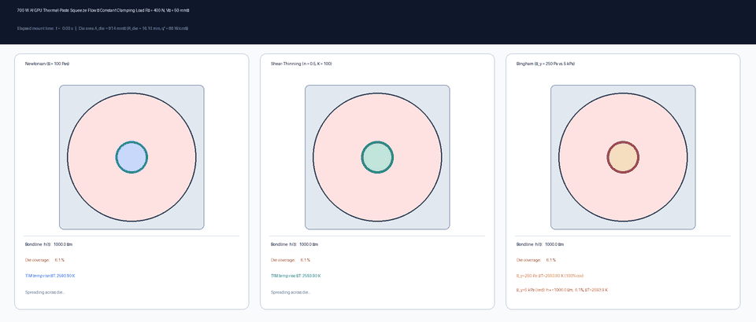
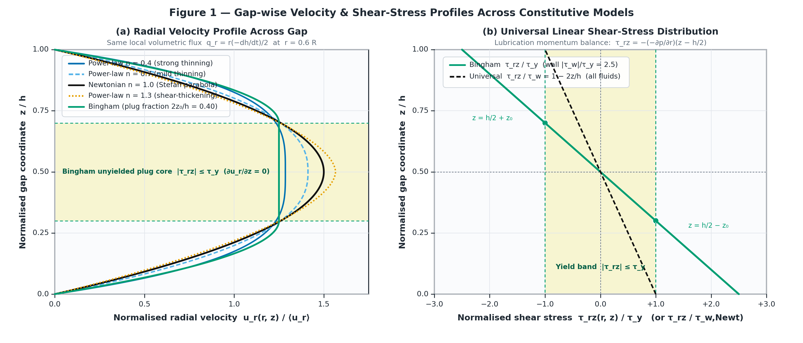
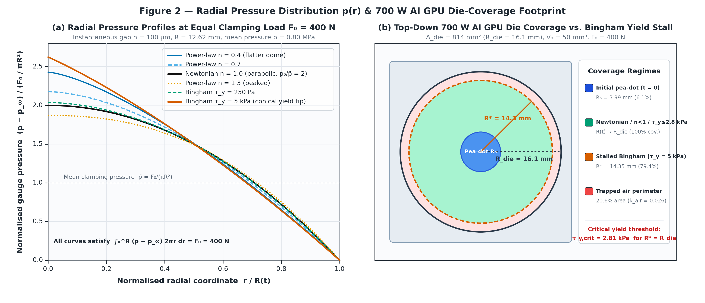
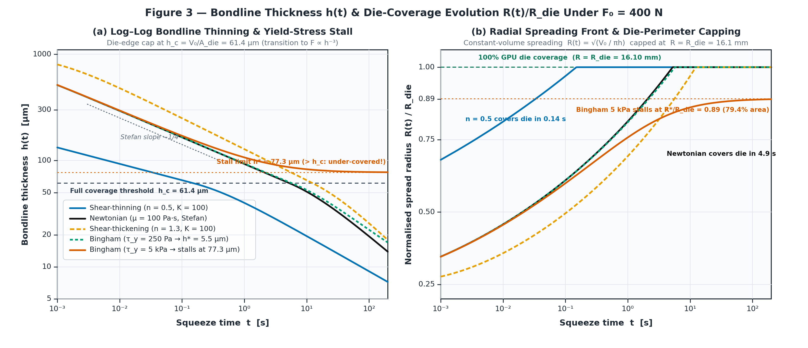
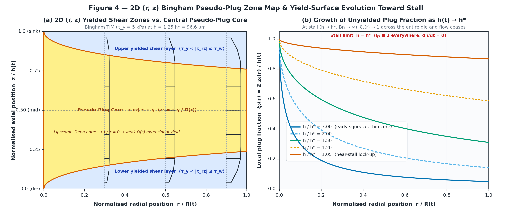
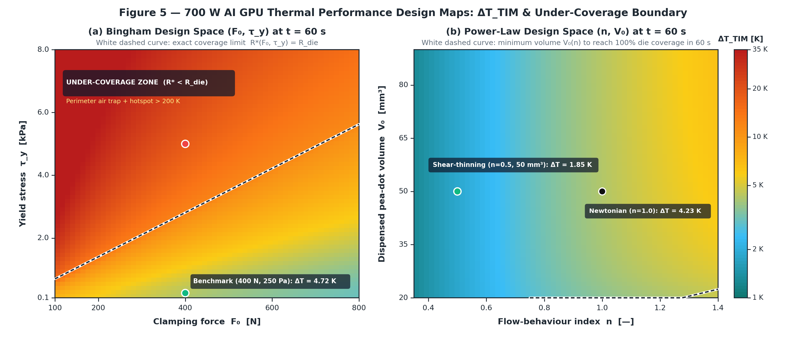
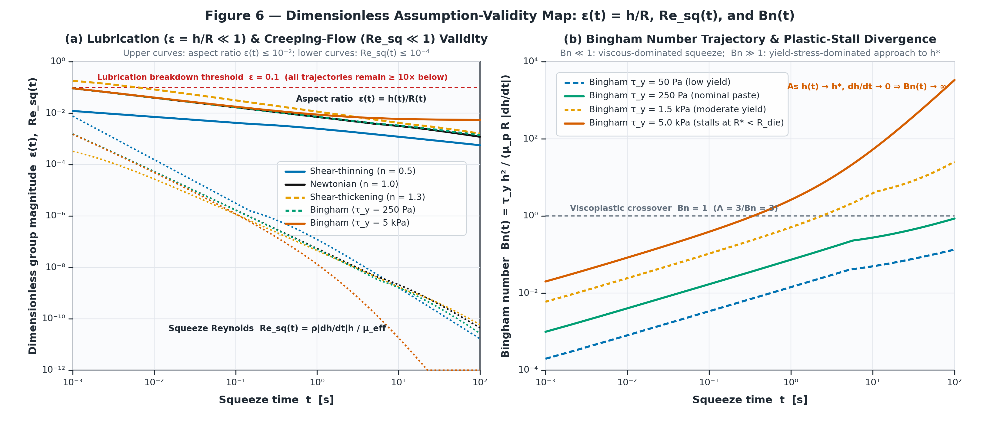

# Squeeze Flow of Non-Newtonian Thermal Interface Materials (TIM) in 700 W AI GPU Packaging

### *First-Principles Transport Phenomena: From Reynolds Transport Theorem & Cauchy Momentum to Rheological Closure and Chip Thermal Bottlenecks*
> **Author & Primary Contributor:** Avanika S (https://github.com/Avani-wai) — *Non-Newtonian Rheology Modeling, Analytical Derivations, Verification Suite & Visualization Pipeline*



---

## 1. Executive Summary & Engineering Problem

Modern AI accelerators (such as 700 W H100-class GPUs, $A_{\text{die}} = 814\text{ mm}^2 \implies R_{\text{die}} = 16.10\text{ mm}$, average heat flux $q'' = 86.0\text{ W/cm}^2$) depend critically on a thin **Thermal Interface Material (TIM)** layer ($k_{\text{TIM}} = 5.0\text{ W/(m}\cdot\text{K)}$) compressed between the silicon die and cold plate under a constant clamping load ($F_0 = 400\text{ N}$). During package assembly, a fixed pea-dot volume ($V_0 = 50\text{ mm}^3$, initial height $h_0 = 1.0\text{ mm}$, $R_0 = 3.99\text{ mm}$) spreads radially outward as the gap $h(t)$ thins.

Guided by the core principle of the course (**"Conservation is universal; closure is material specific"**, *Momentum, Energy and Fluid Flow*, Slide 184), this repository derives, verifies, and visualizes the coupled momentum and energy transport for three rheological families:
1. **Newtonian Fluid (Stefan's Law):** $\tau_{rz} = \mu\dot{\gamma}$ ($\mu = 100\text{ Pa}\cdot\text{s}$)
2. **Ostwald–de Waele Power-Law Fluid (Scott's Law):** $\tau_{rz} = K|\dot{\gamma}|^{n-1}\dot{\gamma}$ ($K = 100\text{ Pa}\cdot\text{s}^n$, shear-thinning $n = 0.5$ vs. shear-thickening $n = 1.3$)
3. **Bingham Yield-Stress Fluid (Covey–Stanmore Lubrication & Lipscomb–Denn Pseudo-Plug Paradox):** $|\tau_{rz}| > \tau_y \implies \tau_{rz} = \tau_y\,\text{sgn}(\dot{\gamma}) + \mu_p\dot{\gamma}$ ($\mu_p = 100\text{ Pa}\cdot\text{s}$, nominal $\tau_y = 250\text{ Pa}$ vs. high-yield stall $\tau_y = 5\text{ kPa}$)

### Benchmark Results at $t = 60\text{ s}$ ($F_0 = 400\text{ N}$, $V_0 = 50\text{ mm}^3$, $\dot{Q} = 700\text{ W}$)

| TIM Rheological Model | Final BLT $h(60\text{ s})$ [$\mu\text{m}$] | Wetted Radius $R(60\text{ s})$ [$\text{mm}$] | Die Coverage [%] | $R_{\text{TIM,eff}}$ [$\text{K/W}$] | Mean $\Delta T_{\text{TIM}}$ [$\text{K}$] | Perimeter $\Delta T_{\text{hotspot}}$ [$\text{K}$] |
|---|---:|---:|---:|---:|---:|---:|
| **Shear-Thinning ($n = 0.5$)** | **10.77** | **16.10** | **100.0 %** | **0.00265** | **1.85** | **0.0** |
| **Newtonian Reference ($\mu = 100\text{ Pa}\cdot\text{s}$)** | **24.62** | **16.10** | **100.0 %** | **0.00605** | **4.23** | **0.0** |
| **Bingham Nominal ($\tau_y = 250\text{ Pa}$)** | **27.45** | **16.10** | **100.0 %** | **0.00675** | **4.72** | **0.0** |
| **Shear-Thickening ($n = 1.3$)** | **33.04** | **16.10** | **100.0 %** | **0.00812** | **5.68** | **0.0** |
| **Bingham High-Yield Stall ($\tau_y = 5\text{ kPa}$, stall $h^*$)** | **77.32** ($h^*$) | **14.35** ($R^*$) | **79.4 %** | **0.02387** | **16.71** | **2557.2** |

> **Key Packaging Takeaway:** While increasing filler volume fraction raises bulk conductivity $k_{\text{TIM}}$, if the yield stress exceeds the critical threshold $\tau_{y,\text{crit}} = \frac{3F_0 h_c}{2\pi R_{\text{die}}^3} = \frac{3F_0 V_0}{2\pi^2 R_{\text{die}}^5} = 2.81\text{ kPa}$, the paste permanently stalls in the plastic limit ($\Phi(\Lambda\to 0)=1$) before reaching the die edge ($R^* < R_{\text{die}}$). The resulting peripheral air gap ($k_{\text{air}} = 0.026\text{ W/(m}\cdot\text{K)}$) causes a **9× higher mean temperature rise** and catastrophic perimeter hotspots.

---

## 2. Repository Structure & Modular One-Way Architecture

```text
Transport_Phenomena-Thermal-paste/
├── code_snippets/
│   └── squeeze_flow_tim.ipynb      # Executed Jupyter Notebook (Equations & Code Side-by-Side)
├── report/
│   └── non_newtonian.pdf           # Physics equations writeup
│   └── report.md
├── AI_rendered simulations/        #Simulations of the models rendered by AI agents             
├── src/
│   ├── params.py                   # Component 1: 700 W GPU benchmark & material dataclasses (single source of truth)
│   ├── rheology_models.py          # Component 2: Analytical & semi-analytical momentum engine (Stefan, Scott, Bingham)
│   ├── thermal_coupling.py         # Component 3: 1D Fourier conduction & parallel TIM/air-gap thermal network
│   ├── diagnostics.py              # Component 4: Buckingham Pi trackers (eps, Re_sq, Bn) & 20 automated checks
│   ├── visuals.py                  # Component 5: Publication SVG->PDF/PNG figure builder & Pillow GIF animator
│   ├── physics_models.py           # Clean unified facade over Components 1–4
│   ├── verify_physics.py           # CLI verification runner (executes all 20 physics checks)
│   └── generate_figures.py         # CLI figure & GIF runner (regenerates all 13 visual artifacts in figures/)
├── figures/                        # 6 publication figures (300 DPI PNG + vector PDF) + gpu_spread.gif
├── requirements.txt                # Python dependencies
└── README.md                       # Project documentation & reproducibility guide
```

---

## 3. Reproducibility Instructions

### Prerequisites
* **Python 3.10+** with standard scientific packages listed in [`requirements.txt`](requirements.txt).

```bash
# 1. Clone the repository and enter the workspace
git clone <your-repo-url>
cd Transport_Phenomena-Thermal-paste

# 2. (Optional) Create and activate a virtual environment
python -m venv .venv
# Windows PowerShell:
.\.venv\Scripts\Activate.ps1
# Linux / macOS:
# source .venv/bin/activate

# 3. Install Python dependencies
pip install -r requirements.txt
```

### Step 1 — Run the 20-Check Physics Verification Suite
Validates every limiting case ($n\to 1$, $\tau_y\to 0$, $\Lambda\to 0$ plastic stall), critical yield stress $\tau_{y,\text{crit}} = 2812.8\text{ Pa}$, ODE-vs.-closed-form power-law agreement, Bingham-vs.-Newtonian thickness ordering, RTT radial flux continuity, integral force balance, constant-volume conservation, asymptotic power-law scaling exponents $h \propto t^{-2n/(3n+5)}$, and dimensional unit invariance:

```bash
python src/verify_physics.py
```
Expected output: `20/20 checks passed` (exit code `0`).

### Step 2 — Regenerate All 6 Publication Figures (300 DPI PNG + Vector PDF) & Animated GIF
Recomputes all trajectories from `src/` and writes `fig1`–`fig6` (`.png` and `.pdf`) plus `gpu_spread.gif` into [`figures/`](figures/):

```bash
python src/generate_figures.py
```

### Step 3 — Explore or Re-Execute the Side-by-Side Jupyter Notebook
Open [`squeeze_flow_tim.ipynb`](squeeze_flow_tim.ipynb) directly in VS Code, JupyterLab, or GitHub. Each derivation milestone pairs the step-by-step equations from the lecture slides side-by-side with the corresponding Python implementation in `src/` and live verification outputs:

```bash
jupyter lab squeeze_flow_tim.ipynb
```

### Step 4 — Compile the LaTeX Report (`report/main.tex`) on Overleaf or Locally
* **On Overleaf (Zero Local TeX Setup):** Upload [`report/main.tex`](report/main.tex) and the vector PDFs in [`figures/`](figures/) (`fig1_velocity_stress.pdf` through `fig6_regime_validity.pdf`) preserving the `report/` and `figures/` folder structure (or place `figures/` next to `main.tex` and adjust `../figures/` to `figures/`). Compile with **pdfLaTeX**.
* **Local TeX Live / MiKTeX Compilation:**
  ```bash
  cd report
  pdflatex main.tex
  pdflatex main.tex
  ```

---

## 4. Publication Figure Gallery

| Figure | Physical Focus | Preview |
|---|---|---|
| **Figure 1** | Cross-gap velocity profiles $u_r(z)/\bar{u}_r$ & universal linear shear stress $\tau_{rz}(z)/\tau_w$ |  |
| **Figure 2** | Normalized radial pressure $(p-p_\infty)/p_{\text{ref}}$ & 700 W GPU die coverage at $t = 60\text{ s}$ |  |
| **Figure 3** | Log–log bondline thinning $h(t)$, Phase 1 $\to$ Phase 2 transition at $h_c = 61.43\,\mu\text{m}$, & $\Delta T_{\text{TIM}}(t)$ |  |
| **Figure 4** | 2D Bingham pseudo-plug morphology $\|z - h/2\| \le z_0(r)$ & master curves $\xi_0(S), \Phi(\Lambda)$ |  |
| **Figure 5** | 700 W AI GPU thermal design maps over $(\tau_y, F_0)$ and $(n, V_0)$ parameter spaces |  |
| **Figure 6** | Dimensionless assumption-validity trajectories: $\epsilon(t) = h/R \ll 1$, $Re_{\text{sq}}(t) \ll 1$, and $Bn(t)$ |  |
