# The Squeeze
> **Author & Primary Contributor:** Pranav Y (https://github.com/irrati0n4l)
*From a throttling processor to a film of paste: a journey through force, flow and heat, rebuilt from the basics of the course*

> Markdown reconstruction of the original PDF. Text is extracted page-wise; original embedded visual assets are included where extractable.

---

<!-- Original PDF page 1 -->

The Squeeze
From a throttling processor to a film of paste: a journey through
force, flow and heat, rebuilt from the basics of the course

A companion story for the Paste Squeeze Lab. It revises the tools of the course as they are
needed, builds the lab’s model as a special case of them, checks whether the model
describes something real, and ends at the doorstep of better paste models (shear thinning,
yield stress).

Where the journey goes

Prologue · The slowdown

1 · Counting what we measure (dimensions, pressure, viscosity)

2 · Which force wins? (force scales, Reynolds number)

3 · Bookkeeping of stuff (control volumes, continuity)

4 · Push and resistance (force balance, Couette, pressure-driven flow)

5 · Squeezing a film (the model, step by step)

6 · Painting paste (how the lab computes it)

7 · From micrometres to degrees (heat in the layer)

8 · Is the ideal model realistic? (an honest audit)

9 · Beyond ideal Newtonian paste

Epilogue · Back to the throttle · Glossary

---

<!-- Original PDF page 2 -->

Prologue

 The slowdown
 You are an hour into a long render. The fans have been rising in pitch, and then,
 without warning, the frame rate sags. Nothing crashed. The processor simply decided
 to run slower.

 That decision is called thermal throttling. A chip has a temperature sensor on the silicon
 itself (the die). When the die reaches a limit, often somewhere near 100 °C, the firmware
 lowers the clock speed so that less power is dissipated and the chip cools. You lose speed
 because heat could not leave fast enough.

 So follow the heat. It is produced in the die, crosses a thin layer of thermal paste, enters a
 metal lid or cold plate, spreads into a heatsink, and finally leaves into moving air. Each
 stage opposes the flow of heat a little, like resistors in series, and the temperature drops
 add up. The paste is the odd one out: it is tens to hundreds of times thinner than the other
 layers, yet it is a poor conductor (a common value is about 5 W/m·K, compared with about
 400 for copper), so a small thickness can cost several degrees.

      Figure 1. The heat path. The paste layer is thin but conducts heat about eighty times worse than copper.

 This story asks three questions about that layer, and answers them using nothing beyond
 the tools of the course:

 1. When a cooler is clamped on with a steady force, how thick is the paste layer afterwards,
 and how long does it take to get there? 2. How many degrees does that thickness cost, and
 what if parts of the die are not covered by paste? 3. How far can we trust the answer, given
 that real paste is not the ideal fluid we model?

  How to read this story
  New symbols are explained at the moment they first appear, not before. Revision of a course
  idea comes first (grey boxes), and then we use it on the paste. The lab’s page contains the same
  equations; its “Explanations” buttons give the compact derivations, while here we go slowly,
  with the reasons. A glossary at the end lists every symbol for quick lookup.

**Embedded visual assets from this page:**

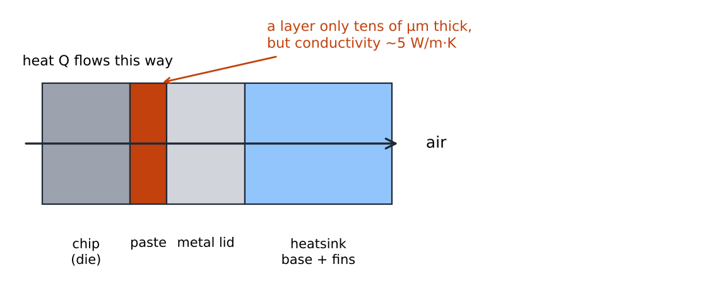

---

<!-- Original PDF page 3 -->

Chapter 1

 Counting what we measure
 Before any physics, we must be sure we are talking about the same things: a force, a
 pressure, a stickiness.

 Dimensions are the “kind” of a quantity; units are the ruler
 The same diameter can be written 0.05 m, 5 cm or 50 mm. The number changes because
 the ruler changes, but the thing measured, a length, does not. We call that kind of quantity
 its dimension, and write [d] = L for length. Everything in mechanics is built from three
 base dimensions: mass M, length L, time T.

 Other quantities get their dimensions from their definitions. Speed is length per time, so
             −1                                                             −2
 [U] = L T        (here U is a speed). Acceleration is speed per time: L T       . A force F is defined
                                                              −2
 by Newton’s law as mass × acceleration, so [F] = M L T            , and its unit, the newton, is 1 N
 = 1 kg·m/s². A pressure p is a force pushing on each unit of area, p = force/area, with unit
 pascal, 1 Pa = 1 N/m². We will mostly use gauge pressure, which means the pressure above
 the surrounding air, so that open air counts as zero.

  Numbers: the clamp
  Your cooler presses with F = 50 N on a flat region 40 mm × 40 mm, area A = 0.04 m × 0.04 m
  = 16 cm² = 0.0016 m². The pressure it would exert if spread evenly is P = F/A = 50 / 0.0016 =
  31250 Pa ≈ 31 kPa, about one third of atmospheric pressure. We write a capital P for this
  applied, average pressure and keep lower-case p for the real pressure inside the paste, which
  will turn out to vary from place to place.

 Viscosity: how much a fluid resists sliding
 Imagine paste as a stack of thin layers that slide over each other. The sliding resistance per
 area is a shear stress, written τ (tau): a force acting along a surface, divided by the area of
 that surface, with unit Pa just like pressure. Newton observed that for simple fluids the
 stress is proportional to how quickly speed changes across the layer:

 Read it slowly. Here u is the fluid speed along the surface, z is the distance measured
 across the layer, so du/dz is the speed difference per unit distance (unit 1/s). The constant
 of proportionality μ (mu) is the viscosity. Since τ is in Pa and du/dz in 1/s, μ must be in
 Pa·s. Water is about 0.001 Pa·s, honey a few Pa·s, and a paste behaving like our default has
 μ = 100 Pa·s: it flows, but slowly. A fluid obeying this law with a constant μ is called
 Newtonian; everything in the main model assumes this. A related quantity, the kinematic
 viscosity ν = μ/ρ (ρ, rho, is the density), has dimensions L² T−1, and later we will see it
 measures how fast momentum spreads.

  Quick self-check (dimensional thinking)
  Is μU/L a pressure? [μ] = M L−1T−1, [U] = L T−1, so μU/L has dimension M L−1T−2. That is
  exactly the dimension of pressure. Checking dimensions like this catches most algebra slips,
  and we will use the idea twice more: for Reynolds’ number and for Buckingham’s theorem.

**Embedded visual assets from this page:**

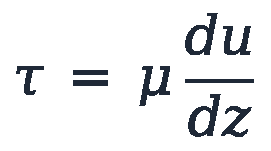

---

<!-- Original PDF page 4 -->

Chapter 2

 Which force wins?
 A flow is a tug-of-war between several possible forces. The trick of the course was to
 estimate each one roughly and see who wins, before solving anything.

 Force scales
 Pick a typical length L of the flow and a typical speed U (an order-of-magnitude estimate,
 not an exact value). Then:

 Inertia is the tendency of a moving fluid to keep moving. It is mass × acceleration. A lump
 of size L has mass ρL³, and its speed changes by about U over a time L/U, so its acceleration
 is about U²/L. Inertia force ≈ (ρL³)(U²/L) = ρU²L².
 Viscous force is shear stress × area. The stress is about μU/L (a speed change U across a
 distance L) and the area is L², giving μUL.
 Pressure force is a pressure difference Δp times L². Gravity is mass × g = ρgL³ (g is the
 gravitational acceleration). Surface tension is γL, with γ (gamma) the surface tension in
 N/m.

 The ratio of the first two is the famous number:

 Re (the Reynolds number) can also be read as a ratio of two times. tadv = L/U is the time
 the flow takes to carry fluid across the length L, and tν = L²/ν is the time viscosity needs to
 spread momentum across the same length. Then Re = tν/tadv. When Re is small, momentum
 spreads across the layer much faster than fluid is carried along, so the flow reacts to its
 boundaries almost immediately and inertia does not matter. Remember this sentence; the
 whole paste model rests on it.

 The same ratios hiding in the momentum equation
 For a fluid whose density and viscosity are constant and which cannot be compressed,
 Newton’s second law applied to a small moving piece of fluid gives the momentum
 equation:

 Here u is the velocity (a vector, with components along x, y, z). ∂/∂t means “how fast it
 changes in time at a fixed place”. The symbol ∇ (“del”) stands for the three derivatives (∂/∂x,
 ∂/∂y, ∂/∂z): ∇p is the pressure gradient, the direction and steepness of the pressure change,
 and ∇² adds up the three second derivatives and measures how sharply the velocity curves.
 The left side is mass-times-acceleration per volume (local change plus change due to being
 carried along). The right side lists the forces per volume: pressure, viscous, gravity.
 Nothing else.

 Now measure every variable in its natural scale: lengths in L, speeds in U, times in L/U, and
 pressure differences in ρU². Writing the scaled variables with stars and dividing the whole

**Embedded visual assets from this page:**

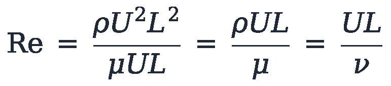

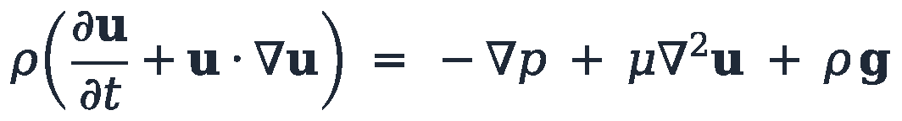

---

<!-- Original PDF page 5 -->

equation by ρU²/L:

 Every term is now a pure number of order one except the two with coefficients. So the
 viscous term carries the factor 1/Re, and gravity carries 1/Fr, where Fr = U²/(gL) is the
 Froude number, inertia over gravity. This is the structural reason dimensionless numbers
 matter: they are the coefficients left in the equation when we make it dimensionless. When
 Re is tiny, 1/Re is huge, the left side is negligible by comparison, and the equation collapses
 to a balance between pressure and viscous force.

  Numbers: is paste flow “slow”?
  Take a paste density ρ ≈ 2500 kg/m³ (an assumed, typical filled-paste value), μ = 100 Pa·s, a
  squeeze speed U 10 µm/s (Chapter 5 gives 3 µm/s and falling) and the plate size L = 40 mm:
                               −5                      −5
  Re = ρUL/μ = 2500 × 1×10 × 0.04 / 100 = 1×10 . Using the much smaller gap h ≈ 100 µm
                                     −8
  as the length gives about 2.5×10 (the exact choice will be justified in Chapter 5). Either way,
                                               5     8
  viscous effects beat inertia by factors of 10 to 10 . The paste creeps like cold honey in slow
  motion. The capillary number Ca = μU/γ, viscous force over surface tension (γ ≈ 0.025 N/m
                          −5
  assumed), is 100 × 10 / 0.025 ≈ 0.04, so surface tension is a small but not absolutely
  negligible effect at the paste edge.

 A second idea from the same toolbox: how far does a disturbance
 reach?
 Suppose a wall in contact with still fluid suddenly starts moving at speed Uw. Viscosity
 drags the neighbouring fluid, which drags the next layer, and so on: the motion spreads into
 the fluid. Over what depth δ? Balance “the change we are trying to cause per unit time”
 Uw/t against “the viscous spreading” νUw/δ² (the diffusion term has dimensions of ν ×
 speed / length²). The speed Uw cancels and δ ~ √(νt): the disturbance depth grows like the
 square root of time. The course turned that scaling into an exact answer using a similarity
 variable, one combined coordinate η = y/(2√(νt)), and we will use precisely this machinery
 for heat in Chapter 7, because heat obeys the same kind of equation, with ν replaced by the
 thermal diffusivity.

**Embedded visual assets from this page:**

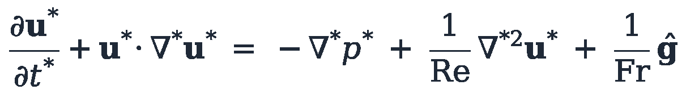

---

<!-- Original PDF page 6 -->

Chapter 3

 Bookkeeping of stuff
 Whatever flows in must stay, or flow out. If you can count carefully, you already know
 half of fluid mechanics.

 Control volumes and the transport theorem
 The course’s favourite device is the control volume (CV): an imaginary region of space,
 fixed or moving as we like, with a closed boundary called the control surface (CS). We do
 not follow individual fluid pieces; we just watch what crosses the boundary. The Reynolds
 transport theorem (RTT) says, in words: the rate of change of any quantity inside the CV
 equals the net rate at which the quantity is carried across the CS (plus any sources inside).

 For mass, the quantity is density ρ, and the rate at which mass crosses a small piece of
 surface of area dA is ρ(u·n)dA, where n is the unit vector pointing out of the CV, so u·n is
 the outward speed. Total mass in the CV is ∫ρ dV. Hence

 Our fluid has constant density and the CV is fixed, so ρ comes out of both sides and the left
 side is zero: the total outward flow of volume is zero,       u·n dA = 0. The divergence theorem
 says that this surface total equals the volume integral of ∇·u, the sum of the local
 “spreading rates” ∂u/∂x + ∂v/∂y + ∂w/∂z (u, v, w are the velocity components). Because the
 CV was arbitrary, the integrand itself must vanish:

 Counting the paste in a column
 Now apply the same counting to our actual problem. Between the two plates, cut out a tall
 thin column of paste with a small square base dx × dy. Its volume is h dx dy, where h is the
 gap. The top plate is pushing down, so the gap shrinks at a speed we call U = −dh/dt (U is
 positive when the plates approach). The column therefore loses volume at the rate U dx dy.

 Where does that volume go? Nothing can pass through the plates, because the moving plate
 is itself a surface that carries the fluid with it. So it must leave sideways through the four
 vertical faces. Define q as the volume of paste crossing the column’s sides per second per
 metre of side length (unit m²/s; it has an x-part q and a y-part q ). Through the face at x +
                                                           x           y
 dx, the paste leaving per second is q (x+dx) dy; through the face at x, q (x) dy enters. The
                                              x                               x
 net outflow in x is therefore [q (x+dx) − q (x)]dy ≈ (∂q /∂x) dx dy, and the same logic
                                       x              x        x
 applies in y. Equating loss to net outflow:

 In words: all the volume the descending plate sweeps out per unit area, U, must be
 carried sideways. This is the first of the three equations of the squeeze model. Notice what
 it does not say: it does not tell us how the paste flows or how fast the plate comes down. For
 that we need forces.

**Embedded visual assets from this page:**

---

<!-- Original PDF page 7 -->

Chapter 4

 Push and resistance
 Forces on a control volume must balance if nothing accelerates. In a slow flow, this is
 all there is.

 Force balance, and the pipe that taught us not to be surprised
 Newton’s second law for a control volume: the sum of the forces on the fluid inside equals
 its rate of change of momentum. If the flow is steady and fully developed (the same shape
 everywhere along the pipe), the momentum inside does not change, so the forces balance
 exactly. In a pipe of cross-section A, the pressure upstream pushes forward with pinA, the
 pressure downstream pushes back with poutA, and the wall pulls back with a friction force
 Fw:

 The liquid is moving, yet the net force is zero: motion does not need a net force, only
 changes of motion do. This is the habit we need: pressure pushes, wall shear resists, and in
 slow flow they cancel locally.

 Couette flow: a moving wall and nothing else
 Place a fixed plate at z = 0 and a plate at z = h sliding at speed Uw in the x direction, with
 fluid in between and no pressure difference along x. Take a thin horizontal slab of fluid
 between heights z and z + dz. The faster fluid above drags it forward with shear stress
 τ(z+dz); the slower fluid below holds it back with τ(z). Balance of forces on the slab:

 Integrating twice gives a straight line, u = C₁z + C₂. The “no-slip” condition says fluid
 touching a wall moves with the wall: u(0) = 0 gives C₂ = 0, and u(h) = U              gives C₁ = U /h.
                                                                                   w               w
 So u/U      = z/h, the linear Couette profile, identical for every h and U       once divided by the
         w                                                                    w
 wall speed. That is why dimensionless profiles are useful.

 Add a pressure gradient: the slit flow
 Now keep both plates fixed but let the pressure vary along x. The same slab, of length dx
 and width dy, now feels a pressure force on its two ends: [p(x) − p(x+dx)] dy dz = −(dp/dx)
 dx dy dz, in addition to the shear forces [τ(z+dz) − τ(z)] dx dy = (∂τ/∂z) dz dx dy. Setting the
 total to zero and dividing by the slab volume:

 This is exactly what the full momentum equation collapses to when inertia is negligible and
 the flow is one-directional: only the pressure term and the viscous term survive. The
 left-hand side of the pipe example, ΔpA = F , is the same statement integrated over a
                                                       w
 whole cross-section. Because the equation is linear in u, the general case with a moving
 wall and a pressure gradient is just the sum of the Couette line and a pressure-driven part.

**Embedded visual assets from this page:**

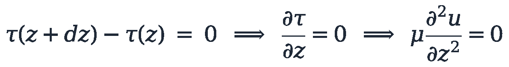

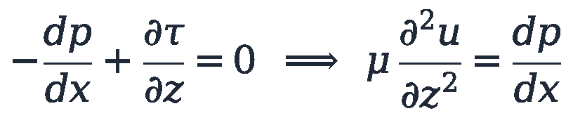

---

<!-- Original PDF page 8 -->

For a fixed wall at z = 0 and at z = h we integrate twice, with the pressure gradient dp/dx
 constant across the gap:

 A parabola that is zero at both plates and fastest in the middle, flowing toward lower
 pressure. Adding up the flow across the gap, with ∫0h z(h−z)dz = h³/2 − h³/3 = h³/6:

 This is the second equation of the squeeze model, and it says something intuitive: the
 sideways flow grows with the cube of the gap (halve the gap and the flow drops eight-fold,
 which is why squeezing gets harder and harder), shrinks with viscosity, and points down
 the pressure gradient.

 How the clamp force enters
 The last piece is the plate itself, treated as a control volume of its own. The cooler presses
 down with a force F = P·A. The paste pushes back up with a pressure p that varies from
 place to place, so its total upward force is the sum of p over all small patches dA of the plate
 that touch the paste, written as an integral. Because the motion is slow (Chapter 2), the
 plate’s own acceleration is negligible and the two forces balance:

 Compare with the pipe: ΔpA = Fw was a force balance with a uniform pressure. Here the
 pressure is not uniform, so we must add up (integrate) its contributions. That is the whole
 link between “a constant applied pressure P” and “the pressure field p(x, y) inside the
 paste”: the field adjusts itself until its total push equals the clamp force.

**Embedded visual assets from this page:**

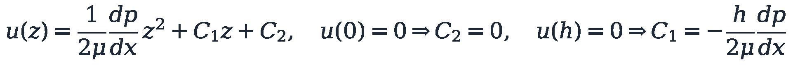

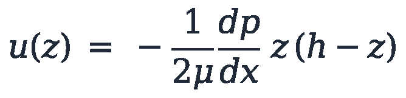

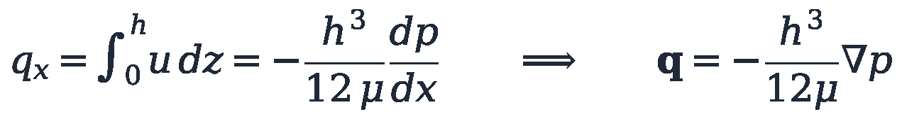

---

<!-- Original PDF page 9 -->

Chapter 5

 Squeezing a film
 Now every ingredient is on the table: dimensions, force scales, the control-volume
 count, the slab force balance, the clamp. Time to assemble the model.

  Figure 2. The setup. A flat plate presses with force F on a film of paste of gap h. The paste is pushed outward; in
                         each column the speed is zero at both plates and largest mid-gap.

 Why the thin gap simplifies the momentum equation
 Let L be the width of the paste patch and h the gap, with the thinness ε = h/L (epsilon), for
                                             −3
 example 50 µm / 40 mm ≈ 1.2×10                   . The sideways speed is called uc and is unknown, but
 continuity (Chapter 3) tells us its size. The plate moves down at U, so the vertical speed is
 about U and varies across the height h, giving ∂w/∂z ~ U/h. Continuity says the sideways
 spreading must balance it: ∂u/∂x ~ uc/L. Setting them equal gives

 The paste moves sideways much faster than the plate descends. Now size each term of the
 x-momentum equation, using t = h/U as the time over which the gap changes:
                                       c

 Term                                      Size (per volume)             Compared with the main viscous term
                                                                         μuc/h²

 time change ρ∂u/∂t                        ρucU/h                        ρUh/μ ≡ Reh (tiny)

 carried change ρu∂u/∂x and ρw∂u/∂z        ρuc²/L = ρucU/h               ρUh/μ = Reh (tiny)

 viscous across the gap μ∂²u/∂z²           μuc/h²                        1 (this is the one that stays)

 viscous along the plate μ∂²u/∂x²          μuc/L²                        (h/L)² ≈ 10−6

 pressure ∂p/∂x                            Δp/L                          must balance the viscous term, so Δp ~
                                                                         μUL²/h³

 Here Re = ρUh/μ is a Reynolds number built from the approach speed and the gap. (A note
             h
 on the project brief: it writes this ratio with an extra factor h/L. With U the approach speed,
 the sizes above give Re itself, because the sideways speed exceeds U by the factor L/h.
                              h
 This changes no conclusion, since the ratio is about 10−8 in both forms.) So inertia and the
 along-plate viscous term drop out. In the vertical direction, the pressure can change across
 the gap by only about μU/h (from the vertical viscous term), which is a fraction (h/L)² of the

**Embedded visual assets from this page:**

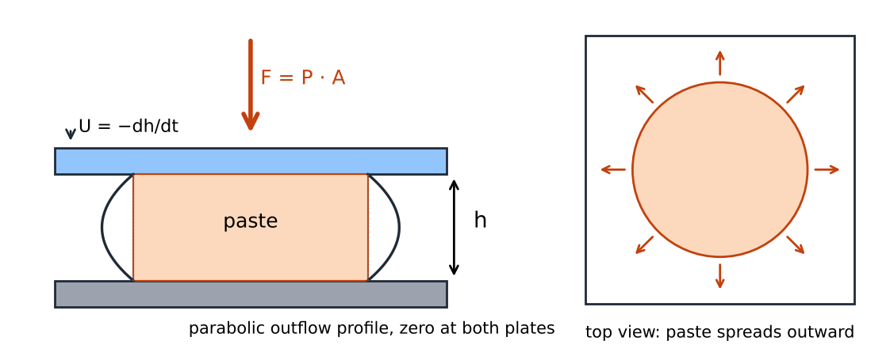

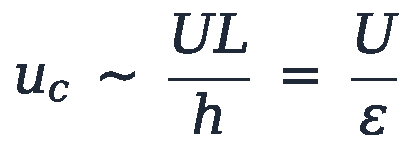

---

<!-- Original PDF page 10 -->

lateral pressure scale, and by ρgh ≈ 2.5 Pa from gravity, against tens of kPa applied. So p
 does not depend on z: p = p(x, y). Only two terms of the whole momentum equation remain,
 and we met them in Chapter 4:

 Therefore the parabolic profile and the flux law of Chapter 4 apply directly: q = −(h³/12μ)
 ∇p. The squeeze film is a slit flow in which the pressure gradient is not given in advance;
 continuity decides it.

 Combining the three equations
 We now have the volume count ∇·q = U (Chapter 3) and the flux law q = −(h³/12μ)∇p
 (Chapter 4). With parallel plates, h is the same at every point and μ is constant, so h and μ
 can be taken outside the divergence:

 Two boundary conditions complete the problem. At the open edge where paste meets air,
 the gauge pressure is zero (p = 0). At a solid wall the paste cannot cross, so q·n = 0, which
 means the pressure does not change in the direction normal to the wall: ∂p/∂n = 0. That last
 condition is how the lab keeps paste from ever leaving the plate.

  Same equation, different dress
  Steady heat conduction in a solid with a uniform heat source q‴ obeys ∇²T = −q‴/k. Replace T
  by p and q‴/k by 12μU/h³, and the pressure problem is the temperature problem. “Pressure is
  zero at the free edge” is “temperature is fixed at the surface”; “no flux through the wall” is
  “insulated wall”. Two physics, one mathematical structure, one solver in the lab.

 Closing the loop with the force
 The equation is linear in p and the only source is proportional to U, so write the pressure as
 a fixed shape times U. Define ψ (psi) as the shape, in m², by p = (12μU/h³) ψ. Then ψ obeys
 ∇²ψ = −1, with ψ = 0 at the free edge and ∂ψ/∂n = 0 at walls. It depends only on the outline
 of the paste. Insert in the force balance and define S = ∫ψ dA (units m⁴):

 Look at what this gives. The approach speed U is found directly from the force, with no
 iteration, because U enters the force linearly. And the pressure field p = Fψ/S contains no h
 and no μ: at a given footprint, the pressure shape is fixed by geometry and the clamp force
 alone. Next, the gap itself: dh/dt = −U = −Kh³ with K = F/(12μS), and while the outline of
 the paste does not change:

**Embedded visual assets from this page:**

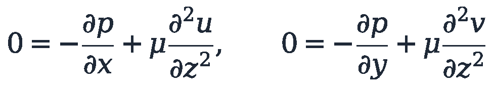

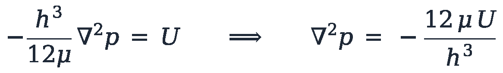

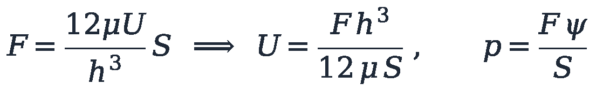

---

<!-- Original PDF page 11 -->

A case we can solve by hand: the full disc
 Let the paste fill a round disc of radius R, centred in the plate. Equal area with the 40 mm
 square means πR² = 1600 mm², so R = 22.57 mm. By symmetry ψ depends only on the
 radius r. The equation ∇²ψ = −1 in a circle reads (1/r) d/dr (r dψ/dr) = −1. Integrate: r
 dψ/dr = −r²/2 + C. The pressure must stay finite at r = 0, so C = 0, giving dψ/dr = −r/2;
 integrate again and use ψ(R) = 0:

   Figure 3. The disc at the default clamp (F = 50 N, μ = 100 Pa·s). (a) Pressure is a parabola with peak 62.5 kPa,
 twice the mean, and is the same at every gap. (b) The gap shrinks slowly, as t−1/2 at late times. (c) Changing μ or
                                                 F only rescales time.

  Numbers: what to expect from the default clamp
  Mean pressure F/A = 31.25 kPa. Peak pressure at the disc centre = 2F/(πR²) = 62.5 kPa,
  exactly twice the mean, as the parabola requires (the average of (R²−r²) over the disc is half its
  peak). Starting from h₀ = 300 µm at constant force, the time to reach 200 / 100 / 50 µm is 17 s
  / 109 s / 475 s, and the approach speed at those gaps is 3.27 / 0.41 / 0.051 µm/s. If instead you
  force the plate down at a fixed U = 10 µm/s, the force needed at those gaps is 153 / 1222 / 9778
  N. The times agree with the reference numbers in the project brief (17 / 109 / 475 s). The
  brief’s fixed-speed forces (0.15 / 1.2 / 9.8 N) do not agree if U is 1×10−5 m/s: the formula gives
  values 1000 times larger, and the brief’s numbers belong to U = 1×10−8 m/s (10 nm/s), as 0.15
  / 1.22 / 9.8 N show. A units slip in the brief, most likely. Either way, notice how brutally the
  force rises as the gap falls: F ∝ h−3.

 Two scaling checks: Buckingham’s theorem and similarity

**Embedded visual assets from this page:**

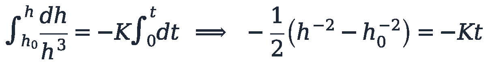

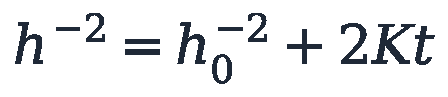

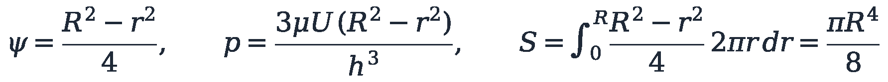

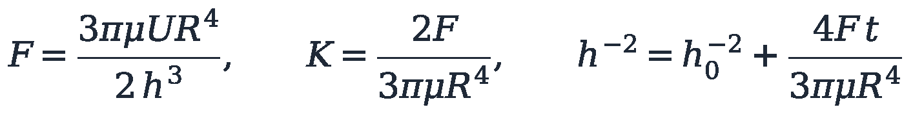

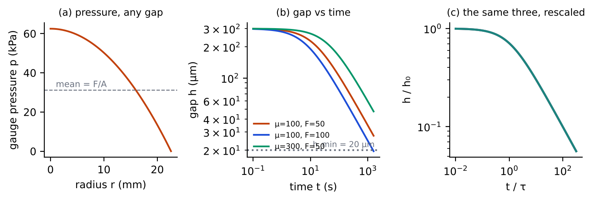

---

<!-- Original PDF page 12 -->

Buckingham. The result F = 3πμUR⁴/(2h³) should not have been a surprise. List the
 variables that could matter: F, μ, U, R, h, five in total. They involve three base dimensions
 (M, L, T), so Buckingham’s theorem says the problem can be described by 5 − 3 = 2
 dimensionless groups. Two good ones are h/R and Π = Fh³/(μUR⁴). Check Π: the top has
                      −2                  −2                           −1 −1       −1                 −2
 dimension M L T           × L³ = M L⁴T      ; the bottom has (M L       T   )(L T    )(L⁴) = M L⁴T      .
 Dimensionless. The theorem only counts groups: Π = Φ(h/R) with Φ unknown. The scale
 analysis supplies the rest: ∇²p = −12μU/h³ gives p/R² ~ μU/h³, so p ~ μUR²/h³ and F ~ pR²
 ~ μUR⁴/h³, which says Φ is a constant that does not depend on h/R. The exact solution fixes
 the constant at 3π/2.

 Similarity. Define a time scale τ = 3πμR⁴/(4F h₀²), which sets how quickly the paste forgets
 its initial gap. Multiply the gap law by h₀² and it becomes (h₀/h)² = 1 + t/τ. Whatever μ, F, R
 or h₀ you choose, plotting h/h₀ against t/τ gives one single curve (Figure 3c). This is the
 same idea as the erfc similarity curve in the moving-wall problem: a solution that depends
 on one combined variable instead of two separate ones. For the default case τ = 13.6 s.

 When the paste does not fill a disc: the spreading blob
 A pea-sized drop starts small and its edge moves outward as the plates close. Its volume Vol
 is conserved, so for a circular blob Vol = πR²h, which gives R² = Vol/(πh): the radius grows
 as the gap shrinks. Substitute R⁴ = Vol²/(π²h²) into the disc force and you get F = 3μU
 Vol²/(2πh⁵). At constant force the gap law changes accordingly (separating variables as
 before, with U = 2πFh⁵/(3μVol²)):

  Figure 4. Force needed for a fixed squeeze speed, for a 0.1 mL paste volume. While the blob spreads, F ∝ h−5;
 once it has reached the size of the plate (here at h = 62 µm) the radius stops growing and the slope becomes −3.

 What happens at the edge of the plate, and when the lab stops
 The lab treats the edge of the plate as a wall. Paste that reaches it is held there and the rest
 fills in toward the corners; no paste is discarded. If you apply the force for a finite time T ,
                                                                                                             f
 the squeeze can end in three ways: (i) the paste has covered the entire plate, so the gap is
 fixed at Vol/A; (ii) the gap has reached the floor h              = 20 µm, a stand-in for the filler
                                                             min

**Embedded visual assets from this page:**

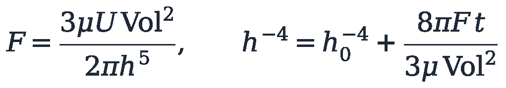

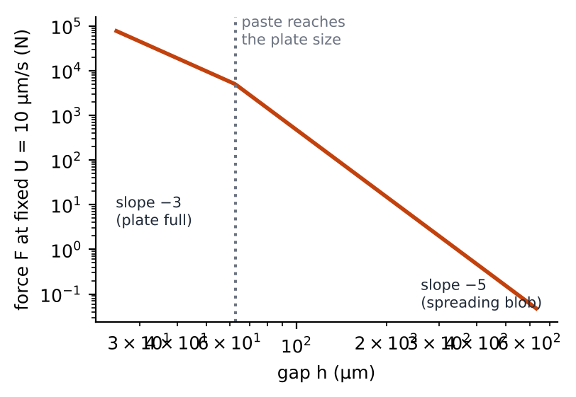

---

<!-- Original PDF page 13 -->

particle size; (iii) the force time is over before either happened, in which case dry regions
 remain. In every case the lab reports whether the paste touched the edges, and unlocks the
 thermal view only after the geometry is frozen.

 If the plate is completely covered, the paste is confined and can only go on by compressing.
 The bulk modulus Kb is defined by Kb = −V dp/dV: the pressure needed per fractional
 volume change. A pressure P therefore compresses the paste by the fraction P/Kb, and the
 final gap is (Vol/A)(1 − P/Kb). With P = 31 kPa and Kb ≈ 2 GPa (an assumed, typical value
 for a silicone-based material) the change is about 1.6×10−5 of the gap: real, but irrelevant.
 It is the lab’s terminal check, not a driver of the dynamics.

---

<!-- Original PDF page 14 -->

Chapter 6

 Painting paste
 The disc is a gift: a closed form. Real deposits are arbitrary shapes, and then the
 computer has to do what we did by hand.

 Deposit to starting shape. Each click, hold or drag adds volume to a map of cells on the
                                                                  1/3
 plate: a click places a dome of volume V (base radius (3V/2π)       , a hemisphere), holding
 extrudes at a steady rate, and dragging while extruding lays a bead whose volume per
 length is the rate divided by the speed. The map is then turned into a pancake: the
 footprint is every cell holding paste, and the starting gap is the paste volume divided by the
 footprint area, h₀ = Vol/(footprint area). Volume is conserved; the early moment when only
 the tops of the domes touch the plate is ignored. This is a stated break point of the model.

 The same equations on a grid. Cut the plate into 64 × 64 cells of size dx. For each wet
 cell, integrate ∇²ψ = −1 over the cell and use the divergence theorem: the sum over the
 four faces of the outward slope of ψ, times the face length dx, equals −dx². Slopes are
 approximated as differences between neighbouring cell values divided by the distance
 between them. Where a neighbour is dry, the front lies inside that cell, at (½ + φ)dx from
 the wet cell’s centre if φ is the fraction of the cell already filled, and ψ = 0 there; this
 “sub-cell” distance reduces the staircase error. The result is one sparse linear system,
 solved by conjugate gradients, the same solver as for temperature.

 Moving the front. From the solution we get S, then U = Fh³/(12μS), and the volume flux
 into each front cell. A front cell becomes wet when its volume reaches the full cell volume h
 dx², and since h falls while it fills, the plate descent Δs needed is found from Vp + ĝΔs = (h
 − Δs)dx². The step ends at the earliest such event (or at the time the animation asks for),
 and time is advanced exactly, because between events h⁻² grows linearly with time. After
 each step the gap is reset so that volume is conserved exactly.

  An honest note on validation
  The numbers quoted in this story come from the closed-form formulas of Chapter 5. The grid
  solver in the lab is built from the same rules, but its comparison with the formulas (the
  full-square against equal-area disc, the blob radius and slope change, the grid refinement 50 /
  100 / 200) is a separate set of checks from the project brief and was not repeated in this
  document.

---

<!-- Original PDF page 15 -->

Chapter 7

 From micrometres to degrees
 The squeeze has stopped and the gap is frozen. Now switch the chip on and ask what
 the paste layer costs.

 Heat flows down temperature gradients: Fourier’s law
 Just as shear stress is proportional to a velocity gradient, the heat flux q″ (heat per second
 per unit area, W/m²) is proportional to the temperature gradient: q″ = −k ∂T/∂z, where k is
 the thermal conductivity. The minus sign says heat flows from hot to cold. The lab describes
 paste by its thermal resistivity r = 1/k in m·K/W; the default r = 0.2 means k = 5 W/m·K.

 Take a slab of paste of thickness dz, with heat q″(z) entering at one face and q″(z+dz)
 leaving at the other. The difference is stored as heat in the slab, ρc dz ∂T/∂t per unit area,
 where c is the specific heat. Therefore ρc ∂T/∂t = −∂q″/∂z = k ∂²T/∂z², or

 α is the thermal diffusivity (m²/s). Compare it with the momentum equation ∂u/∂t = ν
 ∂²u/∂z² from the suddenly moving wall: the two are the same equation with ν replaced by α.
 Everything the course taught about that wall carries over to heat: the penetration depth
 √(αt), the similarity variable, and the Fourier number, which we meet shortly.

  Why one dimension is enough
  Heat can flow along the plate as well as across the gap. The across-gap gradient scales as
                                                                     −6
  ΔT/h², the along-plate one as ΔT/L², so their ratio is (h/L)² ≈ 10 . Each column of paste
  conducts essentially straight through. In the lab the die is a central square held at one
  temperature; outside it the top plate is insulated, so nothing drives heat there. Because both
  plates are held at fixed temperature, no Biot-number question arises: Bi = hcLc/k compares
  convective to internal resistance of a solid cooling into a fluid, and here nothing cools into a
  fluid at the faces.

 Steady state: thickness becomes resistance
 Wait long enough and temperature stops changing: ∂²T/∂z² = 0. Integrate twice: T is a
 straight line in z. Fix the heatsink face at T(0) = T and the die face at T(h) = T                        , with ΔT =
                                                                     s                                 die
 T       − T , to get T = T + ΔT z/h, and the flux is the same at every height:
   die        s                       s

 R″ = r h is the thermal resistance per unit area (m²K/W): thickness times resistivity. It is
 like an electrical resistor, and resistors in series add, so the whole stack from die to air has
 R           =R              +R           +R      +R       + ..., and the die temperature is T        =T      +Q
     total        die-side     paste        lid     sink                                        die     air
 R        , for a heat flow Q in watts. The paste’s share, over a die of area A = 20 × 20 mm = 4
     total                                                                                  d
 cm², is R             = r h/A .
              paste               d

**Embedded visual assets from this page:**

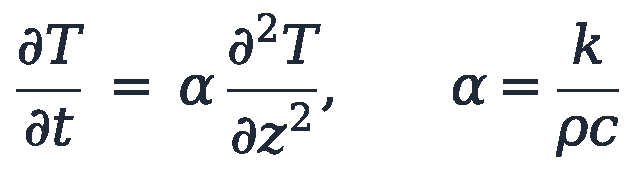

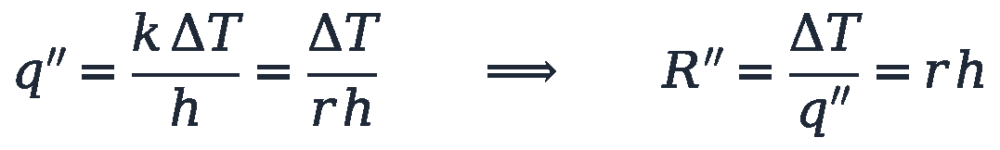

---

<!-- Original PDF page 16 -->

Figure 5. (a) After the die heats at t = 0 the profile relaxes from a thin hot skin to a straight line (Fo is defined
   below). (b) The die-face flux starts high and settles to the steady value. (c) The cost of thickness: a 100 W chip
                             loses 1 K across 20 µm of this paste and 10 K across 200 µm.

  Numbers: degrees from thickness (die 20 × 20 mm, r = 0.2 m·K/W)
  Rpaste = r h / Ad = 500 K/W per metre of gap: 0.010 K/W at 20 µm, 0.025 at 50 µm, 0.050 at
  100 µm, 0.10 at 200 µm. At 100 W the paste layer alone drops 1.0 / 2.5 / 5 / 10 K. A thick layer
  can hand you 10 K, which on a chip with a 100 °C limit means several hundred megahertz of
  lost clock.

 Uncovered patches: conductances in parallel
 Where the die is not covered by paste, the gap is filled with air, kair = 0.026 W/m·K, about
 200 times worse. A cell that is partly covered, with covered fraction φ, offers two paths for
 the same ΔT; for parallel paths we add conductances (heat flow per area per degree, G =
 1/R″), each weighted by its area share:

 For h = 50 µm the resistance rises from 0.025 K/W (full coverage) to 0.028 for 90 %
 coverage, 0.036 for 70 %, and 0.050 for 50 %. Because air carries almost nothing, the
 resistance goes up roughly as 1/(covered fraction). A bad spread is not a small effect: it is a
 direct route to throttling, which is why the lab lets you paint the paste and then look at the
 heat flux map.

 The warm-up: a similarity solution again
 Before steady state there is a warm-up. Non-dimensionalise: let x = z/h, θ = (T − T )/ΔT and
                                                                                                             s
 Fo = αt/h², the Fourier number (elapsed time divided by the diffusion time h²/α of the
 layer). The chain rule gives ∂T/∂t = ΔT(α/h²)∂θ/∂Fo and ∂²T/∂z² = (ΔT/h²)∂²θ/∂x², so the
 equation becomes ∂θ/∂Fo = ∂²θ/∂x² with θ = 0 on the heatsink face, θ = 1 on the die face for
 Fo > 0, and θ = 0 at the start. No material property is left. This is why every paste column
 in a frozen geometry shares one profile and why a different geometry only changes h (hence
 Fo) and the coverage, not the shape of the curves.

 Early time (Fo          1). The heat has not crossed the layer, so the die side looks like a
 half-space. This is exactly the moving-wall problem: with s the distance from the die face
 and η = s/(2√(αt)), the chain rule gives ∂η/∂t = −η/(2t) and ∂η/∂s = 1/(2√(αt)). Writing θ = 1

**Embedded visual assets from this page:**

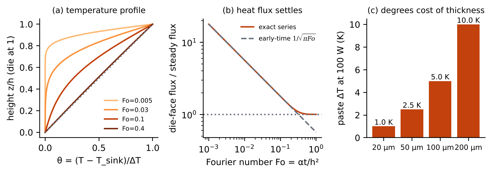

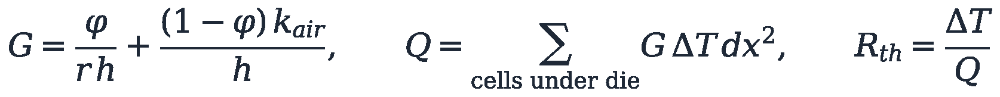

---

<!-- Original PDF page 17 -->

− f(η), the equation becomes f″ = −2ηf′ (primes mean d/dη). Set g = f′: g′ = −2ηg, so g =
 Ae−η². The conditions f(0) = 0 and f(∞) = 1 give A = 2/√π, hence θ = erfc(η), the same erfc
 curve as for the wall. Its slope at s = 0 gives the die-face flux q″ = kΔT/√(παt).

 All times. Split θ = x + θtr. The first term is the steady line. The transient part has zero
 values on both faces and starts as −x. Separate variables, θtr = X(x)G(Fo): the equation
 forces X″/X = G′/G = −λ², negative because a positive constant would blow up in time. Then
 X = A sin λx + B cos λx; X(0) = 0 gives B = 0 and X(1) = 0 gives sin λ = 0, so λ = nπ, and G
 = e−n²π²Fo. Adding modes, θtr = Σ bn sin(nπx) e−n²π²Fo. At Fo = 0 we need −x = Σ bn
 sin(nπx). Multiply by sin(mπx) and integrate 0 to 1: the integral of sin(nπx)sin(mπx) is ½
 when n = m and zero otherwise, so bm = −2∫01 x sin(mπx)dx = 2(−1)m/(mπ) (integrate by
 parts). The answer is

                                                                       n            −n²π²Fo
 Differentiating gives the heat flux, q″ = (kΔT/h)[1 + Σ 2(−1) cos(nπx) e                  ]. At the die
 face every term is positive (flux above steady), at the heatsink face the terms alternate (flux
 starts near zero), and at large Fo everything reduces to the steady kΔT/h. The slowest
                                           −π²Fo
 mode, n = 1, has amplitude (2/π)e                , which falls to 1 % at Fo ≈ 0.4. So the layer settles
 in a time t ≈ 0.4h²/α.

  Numbers: how fast is the paste layer?
                              6           −6
  α = k/(ρc) = 5 / (2.5×10 ) = 2×10 m²/s (ρc = 2.5 MJ/m³K is an assumed typical value). For h
                            −5         −6
  = 50 µm, t ≈ 0.4 × (5×10 )² / (2×10 ) = 0.5 ms. The paste layer itself equilibrates in
  milliseconds. The seconds-to-minutes warm-up you notice on real hardware is the metal lid and
  heatsink (large thermal mass) heating up, which this lab does not model; the paste playback in
  the lab is slow-motion on purpose.

**Embedded visual assets from this page:**

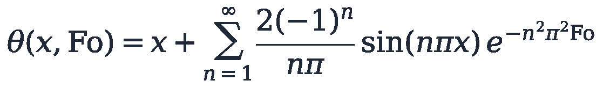

---

<!-- Original PDF page 18 -->

Chapter 8

 Is the ideal model realistic?
 A model can be internally perfect and still describe nothing. So let us audit it against
 the world, the way you would before trusting its numbers.

 The table compares every default of the lab with what I understand to be typical for real
 hardware. I have not looked these ranges up for this document: they are general
 engineering knowledge to be confirmed against the datasheets of your actual paste, cooler
 and processor.

 Quantity        Lab default                Typical real range (confirm for your       Verdict
                                            parts)

 Clamp load      50 N on 40 × 40 mm =       Cooler mounting loads of tens to a few     Plausible, on the low side. The
                 31 kPa                     hundred newtons over a few cm² to          slider goes to 200 kPa.
                                            tens of cm²; pressures of order 104–106
                                            Pa

 Paste           100 Pa·s, constant         Greases are shear-thinning; apparent       Plausible as one “effective”
 viscosity                                  viscosity from about 1 to over 1000 Pa·s   value; constancy is the
                                            depending on shear rate                    idealisation (Chapter 9).

 Conductivity    k = 5 W/m·K (r = 0.2)      Common pastes about 1 to 12 W/m·K          Plausible, mid-range.

 Gap floor       20 µm                      Final bond lines of order 20–100 µm, set   Plausible as a stand-in.
                                            by filler size and pressure

 Plate and die   40 × 40 mm plate, 20       Large desktop lid about 30–45 mm; die      Plausible for a desktop-class
                 × 20 mm die                a fraction of it                           part.

 Die limit       100 °C                     Many chips begin throttling between        Plausible.
                                            roughly 90 and 105 °C

 Flow regime     Re ~ 10−8; (h/L)² ~        n/a: these follow from the numbers         Lubrication assumptions are
                   h
                   −6
                 10 ; gravity ~ 2.5 Pa      above                                      very well satisfied.

 Squeeze time    475 s to reach 50 µm       Real pastes spread in seconds to           Order of magnitude plausible;
                 at 31 kPa                  minutes, then change slowly over hours     but a Newtonian model never
                                            of thermal cycling                         rests (Chapter 9).

 Paste ΔT        T
                   die
                       = 100 °C, T
                                   sink
                                        =   A consumer chip dissipates about           Not realistic as a power
                 40 °C fixed                50–250 W                                   scenario. At 62 µm, R =
                                                                                       0.031 K/W, so a 60 K drop
                                                                                       means about 1.9 kW through
                                                                                       4 cm².

  The one place the defaults mislead, and how to use the model correctly
  The paste physics is linear in ΔT: flux and power scale in direct proportion, and the
  temperature shape and the warm-up time are independent of ΔT. A fixed 60 K across the paste
  is therefore a legitimate mathematical case but not a real chip. To represent a real chip, ask
  what the paste would drop at the real power: ΔT         = Q·R . For a 100 W chip and a 62 µm
                                                    paste      th
  gap, that is about 3.1 K. Set the die and heatsink temperatures to differ by that amount (for
  example 45.0 °C and 41.9 °C) and the lab’s heat-flux map, resistance and profiles then describe
  a 100 W chip. The printed power scales with ΔT; the resistance R does not. This is the number
                                                                     th
  that matters for throttling.

 Verdict. For its stated purpose (first-order sizing of gap, settling time and paste resistance
 for a Newtonian paste between parallel plates) the model is physically consistent and its
 default numbers sit in realistic ranges, with the one exception above. What it cannot do is
 predict the final bond line of a real paste, because a Newtonian fluid has no resting
 thickness. That limit is where we go next.

---

<!-- Original PDF page 19 -->

Chapter 9

 Beyond ideal Newtonian paste
 Every derivation so far leaned on one line: τ = μ du/dz with μ constant. Change that
 line, and the whole story reshapes.

 Real thermal pastes are suspensions of hard filler particles in a silicone or oil carrier.
 Measured on a rheometer (a device that shears a sample at a chosen rate and reports the
 stress), they typically show two departures from Newton: the apparent viscosity falls as
 shear rate rises (shear thinning), and the paste does not flow at all below a threshold
 stress (yield stress). The same chain of reasoning as before, with a different stress law in
 place of τ = μ du/dz, gives better models.

  Figure 6. (a) Stress against shear rate for three behaviours. (b) The same clamp (50 N, equal-area disc, h₀ = 300
               µm) acting on three pastes. The parameters are illustrative, not fitted to any real paste.

 Rung 1: shear thinning (power law)
                                           n
 Replace the stress law by τ = K γ̇ , where γ̇ (gamma-dot) = −du/dz is the shear rate, K is
 the consistency and n the flow index (n = 1 recovers Newton with K = μ; n < 1 means
 thinning). The slab force balance of Chapter 4 does not care about the stress law; it still
 says ∂τ/∂z = dp/dx. Measure z from the centre of the gap (so the shear stress is zero there
 by symmetry) and call G = −dp/dx; then τ = G z, the stress grows linearly from the centre.
 So −du/dz = (Gz/K)1/n, and with u = 0 at the wall, z = h/2 ≡ H:

 Check: n = 1 gives q = (2/3)(G/μ)H³ = h³G/(12μ), the Chapter 4 result. For a disc, continuity
 alone fixes the flux whatever the paste is: (1/r) d(rq)/dr = U gives q = Ur/2. Solving the
 power law for G, G = C rn with C = 2K((2n+1)/n)nUn/h2n+1. The force is F = ∫p dA = π∫ R G
                                                                                                              0
 r² dr (integrate ∫p r dr by parts, using p(R) = 0), so

 With U = −dh/dt at constant force, the gap law is h−(n+1)/n = h₀−(n+1)/n + ((n+1)/n)A t,
 where A is a constant built from F, K, n, R. For n = 1 this is the familiar h−2 law; for n = 0.5

**Embedded visual assets from this page:**

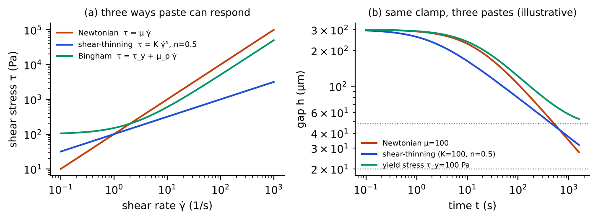

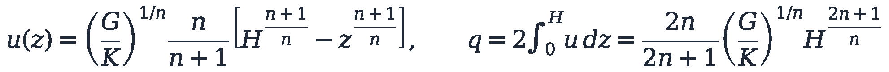

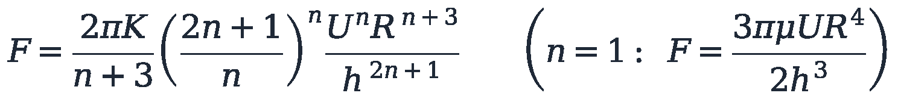

---

<!-- Original PDF page 20 -->

the exponent is 3. In Figure 6b the shear-thinning paste (K = 100 Pa·sn, n = 0.5, chosen to
 match the Newtonian viscosity of 100 Pa·s at a shear rate of 1/s) squeezes faster at first,
 because at the higher early shear rates its viscosity is lower. Later the gap and the shear
 rate fall, its viscosity rises, and the Newtonian curve overtakes it: at 1000 s the
 shear-thinning paste is at 37 µm and the Newtonian one at 35 µm. So thinning changes the
 shape of the approach, not just its speed. The pressure profile also changes shape: p ∝ Rn+1
 − rn+1, which is flatter in the middle and steeper at the edge than the Newtonian parabola.
 Consequence for the lab: μ becomes an effective viscosity μeff = K γ̇n−1, evaluated at a
 typical shear rate (about uc/h), which is why 100 Pa·s can be a reasonable single number
 but changes when you change the clamp force or the gap.

 Rung 2: yield stress (Bingham)
 A Bingham paste behaves like a solid for stresses below a yield stress τy and flows like a
 Newtonian fluid above it: τ = τy + μpγ̇ (μp is the plastic viscosity). In the gap the stress is τ
 = Gz, so the central part of the gap, where |z| < τy/G, does not shear at all: it moves as a
 rigid plug. When the pressure gradient G falls to the value that puts even the wall stress at
 the yield value, G·h/2 = τy, the plug fills the whole gap and the squeeze stops, however long
 you wait. Ask what the force is then. The pressure gradient everywhere equals its minimum,
 G = 2τy/h, so with p = 0 at the edge of a disc, p(r) = (2τy/h)(R − r) and

 This is a result no Newtonian model can give: the final thickness is set by the clamp
 force and the yield stress, and it falls as you press harder, which is what is seen in
 practice. For the illustrative τy = 100 Pa and our disc, hstop = 48 µm. The curve in Figure
 6b uses a simple additive approximation (viscous force plus yield force), which has the right
 two limits (τy → 0 is Newtonian, U → 0 is the stop condition) but is not the exact Bingham
 solution; it is meant to show the qualitative change. A paste that resists flow to a finite
 thickness also needs a minimum-gap rule: here the lab’s fixed 20 µm floor stands in for it,
 and in reality filler particles jam at a similar scale.

 Rung 3 and beyond
 Most real pastes show both effects, a yield stress and thinning above it. The
 Herschel–Bulkley law, τ = τ + K γ̇n, contains Newtonian (τ = 0, n = 1), power-law (τ =
                                      y                                         y                                       y
 0) and Bingham (n = 1) as special cases; smooth laws such as Cross or Carreau add a
 plateau viscosity at very low and very high shear. All of them replace only the “stress law”
 step; the continuity equation, the slab force balance, the clamp force balance and the
 structure of the thermal problem stay as they are in this story.

 A map from the Newtonian model to the real world
 Real effect               What it changes in the equations                    Direction of the effect on the paste
                                                                               layer

 Shear thinning            Stress law τ = Kγ̇n replaces τ = μγ̇; q(G)          Faster initial squeeze; flatter pressure
                           becomes nonlinear (Rung 1)                          profile; effective μ depends on force
                                                                               and gap

 Yield stress              Stress law has τy; plug in the gap; flow stops at   Finite final thickness that falls with
                           G h/2 = τy (Rung 2)                                 clamp force; Newtonian h⁻² law
                                                                               replaced by an asymptote

**Embedded visual assets from this page:**

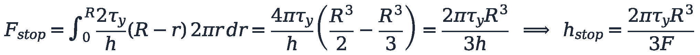

---

<!-- Original PDF page 21 -->

Real effect                What it changes in the equations                   Direction of the effect on the paste
                                                                               layer

 Filler jamming,            Gap cannot fall below a few filler diameters;      Sets hmin; sometimes fluid squeezes out
 minimum bond line          paste is a two-phase mix, not one fluid            leaving particles (“filtration”)

 Viscosity depends on       μ becomes μ(T); flow and heat equations            Hot paste squeezes faster; the
 temperature                couple                                             decoupled model underestimates
                                                                               late-time thinning

 Surface tension and        Pressure jump γ/h at the front instead of p = 0;   About 500 Pa against tens of kPa here,
 wetting                    contact angle                                      so small, but matters for small clamp
                                                                               loads and for air-void formation

 Tilt, torque, off-centre   Plate no longer parallel: h(x, y) varies; the      Wedge-shaped bond line; a real cooler
 paste                      lubrication equation has h inside the derivative   tilts if the paste is off-centre

 Roughness, contact         Extra R″c at each interface added in series to r   Often comparable to the bulk term for
 resistance                 h                                                  thin layers, so R″ = r h underestimates
                                                                               the true resistance

 Air entrapment, voids,     Coverage φ becomes time dependent; dry             Resistance rises over months (the
 pump-out, drying           patches grow with thermal cycling                  coverage formula of Chapter 7 shows
                                                                               the cost)

 Heat spreading, power      Lid and sink conduction (lateral) added;           The die temperature for a given power;
 fixed, heat capacity       Neumann (power) instead of Dirichlet               the minute-scale warm-up; hot spots
                            (temperature) boundary conditions; Biot
                            number matters

 Your other set of codes, which explore these non-idealities, picks up exactly at these rungs.
 Each one swaps one step of the chain we built (the stress law, the minimum gap, the
 temperature coupling, the boundary conditions of the heat problem) and keeps the rest.
 That is the real payoff of building the ideal model from first principles: you know which line
 of the derivation each real effect breaks.

---

<!-- Original PDF page 22 -->

Epilogue

 Back to the throttle
 Return to the render and the sagging frame rate. You now have a way to think about
 it, and three honest numbers to ask for.

 How thick is the paste layer? Set by the clamp force, the paste volume and how it is
 spread, through h⁻² = h₀⁻² + 2Kt for a Newtonian paste, or through a yield-stress stop for a
 real one. How many degrees does it cost? ΔTpaste = Q r h / Ad for a fully covered die,
 divided by the covered fraction if there are voids. How sure are we? Sure about the
 structure and the scalings; unsure about the exact rheology, which is why the effective
 viscosity and the yield stress would need to be measured for a real paste.

 And the larger lesson of the course is visible in every chapter: dimensions told us which
 forces exist; their ratios told us which could be dropped; control volumes and force
 balances gave the few equations that remained; scaling and similarity turned them into
 closed forms; the same equation turned up in momentum and heat. A throttling laptop is a
 special case.

 The chain of equations in one table
 Course idea                      Equation in this story                                        Where it came from

 Newton’s law of viscosity        τ = μ du/dz                                                   Chapter 1
                                                                     −8
 Force scales, Reynolds           Re = ρUL/μ; Reh = ρUh/μ ≈ 10                                  Chapter 2, 5
 number

 Mass balance on a control        ∇·q = U                                                       Chapter 3
 volume

 Force balance on a slab          μ ∂²u/∂z² = dp/dx; q = −(h³/12μ)∇p                            Chapter 4

 Force balance on the plate       F = ∫p dA; U = Fh³/(12μS)                                     Chapter 4, 5

 Combination                      ∇²p = −12μU/h³; h⁻² = h₀⁻² + 2Kt                              Chapter 5

 Buckingham, scaling              Fh³/(μUR⁴) = 3π/2 (disc); t/τ collapse                        Chapter 5

 Fourier’s law, resistance,       q″ = ΔT/(rh); G = φ/(rh) + (1−φ)kair/h                        Chapter 7
 conductance

 Similarity, Fourier number       θ = erfc(η) early; series for all Fo; tsettle ≈ 0.4h²/α       Chapter 7
                                       n    2n+1
 Better paste laws                F ∝ U /h         ; hstop = 2πτyR³/(3F)                        Chapter 9

 Glossary of symbols
 Symbol                           Meaning (unit)

 F, P, A                          clamp force (N), applied average pressure F/A (Pa), plate area (m²)

 p, Δp                            gauge pressure inside the paste (Pa), pressure difference (Pa)

 h, h₀, hmin, U                   gap, starting gap, floor gap (m); approach speed U = −dh/dt (m/s)

 x, y, z; u, v, w                 coordinates along and across the plates; velocity components (m, m/s)

 μ, ν, ρ                          viscosity (Pa·s), kinematic viscosity μ/ρ (m²/s), density (kg/m³)

 τ, γ̇                            shear stress (Pa), shear rate (1/s)

 Re, Reh, Fr, Ca                  Reynolds, gap Reynolds, Froude, capillary numbers (dimensionless)

 L, R, ε                          width of the paste patch, disc radius, thinness h/L

 q, uc                            volume flow per metre of width (m²/s), sideways speed scale (m/s)

 ψ, S                             pressure shape (m²) and its area integral (m⁴)

---

<!-- Original PDF page 23 -->

Symbol                           Meaning (unit)

 K, Kb                            gap-law constant F/(12μS) (1/(m²s)); bulk modulus (Pa)

 Vol, φ                           paste volume (m³); fraction of a cell covered by paste

 k, r, α, c                       thermal conductivity (W/m·K), resistivity 1/k (m·K/W), diffusivity k/(ρc) (m²/s),
                                  specific heat (J/kg·K)

 q″, R″, G, Rth                   heat flux (W/m²), resistance per area (m²K/W), conductance per area (W/m²K), total
                                  resistance (K/W)

 T, Ts, Tdie, ΔT, θ               temperature; heatsink and die temperatures; their difference; scaled temperature
                                  (T−Ts)/ΔT

 Fo, η                            Fourier number αt/h²; similarity variable

 n, K (rheology), τy, μp          flow index; consistency (Pa·sn); yield stress (Pa); plastic viscosity (Pa·s)

